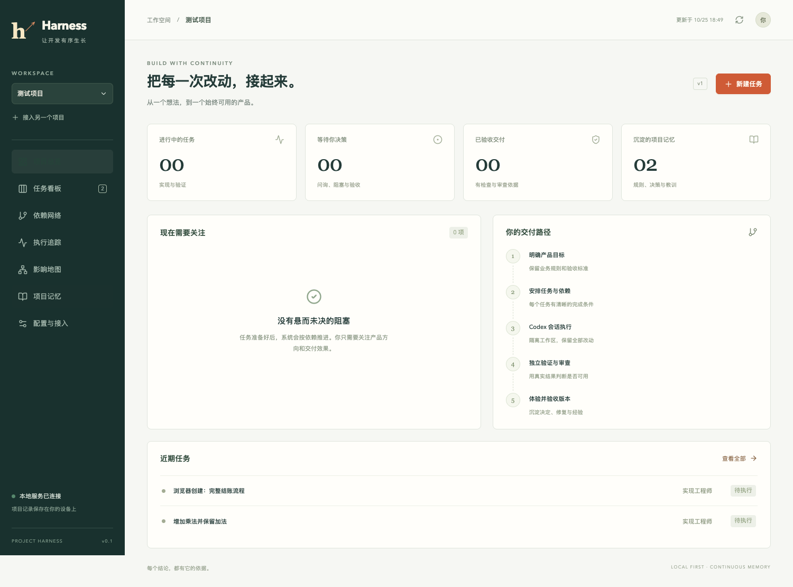

# Codex Project Harness

给产品负责人使用的本地开发工作台。用 Codex 讨论产品，用看板安排任务；需求、工作区、原生会话、真实检查、独立审查和验收保持关联。项目记录保存在自己的 Git 仓库中。

这是可运行的 **0.1 首版**，默认 macOS、单人、本地多项目。实际验收范围和剩余限制见 [验收记录](docs/acceptance.md)。

第一次使用请看 [快速上手](docs/quickstart.md)：包含可复制命令、在 Codex 中的启动提示词，以及每天的使用顺序。



## 现在使用

在本仓库安装并构建工具：

```sh
npm ci
npm run build
```

然后按下节接入要开发的产品项目。

Node.js 最低 20.9；需要 Git 和已登录的 Codex。实际 App Server 验收使用 macOS 桌面包内的 Codex 0.159.2。程序优先选桌面附带的可执行文件，随后使用 PATH 中的 `codex`。可通过 `HARNESS_CODEX_BIN` 或项目 `codexBin` 指定，不修改全局模型设置。

## 接入你的项目

```sh
node /绝对路径/develop_harness/dist/cli.js init /你的项目 "产品名称"
node /绝对路径/develop_harness/dist/cli.js connect --project /你的项目
node /绝对路径/develop_harness/dist/cli.js start --project /你的项目 --port 4318
```

`/你的项目` 是要开发的产品仓库路径。打开 `start` 打印的完整本地链接。它启动后台进程，关闭浏览器不停止服务；使用 `node /绝对路径/develop_harness/dist/cli.js stop --project /你的项目` 停止服务。电脑休眠或服务退出后，原会话、工作区与证据仍保留，恢复时先核对，不盲目重派。`serve` 是前台调试入口。

也可以在已打开的看板左侧选择“接入另一个项目”，由一个服务管理多个项目。每个项目只允许一个服务拥有运行权。

`connect` 在项目 `.codex/config.toml` 添加 MCP 入口，保留原配置。重新加载 Codex 项目后，就可以通过工具读取当前任务和知识。它不会替你开启 Codex 的信任或权限设置。

想装成可移动的工具包：运行 `npm pack`，再在目标工具目录运行 `npm install /完整路径/codex-project-harness-0.1.0.tgz`，通过 `npx harness` 使用。没有发布到 npm，也没有安装机器级服务。

初次接入可以直接在 Codex 中说：

> 请用项目的 harness-work 技能接管这个项目。先读取项目概览，盘点已有用户流程、代码、检查和有效文档；未经验证的能力保持未知。我的产品目标是：……。帮我明确第一版范围和验收条件，配置真实行为检查，建立可恢复的 Git 基线。保留已有文件。把任务和依赖放进 Harness，待我确认目标后执行。

先完成“配置与接入”里的检查配置，再保存 Git 基线；未提交的代码会阻止自动创建工作区。新项目的技术选型与产品骨架仍由 Codex 根据产品需求完成，Harness 不预设框架。

## 可复制的 Agent 指引

[AGENTS.md](AGENTS.md) 是给目标软件项目直接复用的通用开发指引。将它放入目标项目根目录；已有同名文件时保留原有约束并合并。它从目标项目读取技术栈和检查命令，包含需求变更、职责分工、回归验证、缺陷闭环与长期记忆规则。

仅复制文件即可采用这些工作约定；看板、MCP 与自动调度仍需按上面的步骤接入。`init` 保留目标项目已有 `AGENTS.md`，仅在缺少 Harness 入口时补充简短指引；不会覆盖整份项目规则。安装包也包含这份可复制文件。

## 日常使用

1. 在对话或看板提出需求，明确受影响的已有行为与验收条件。
2. 确认范围并纳入计划。默认手动派发；打开自动派发后，已授权且依赖就绪的任务按优先级启动，最多并行三个。相同或未说明的模块范围串行。
3. 每个任务使用 Git worktree 和新的持久 Codex 会话。卡片可打开实现与审查会话。暂停、核对、恢复都保留原工作。
4. 真实检查通过后，在另一个只读会话审查明确的提交差异。执行结束不会自动成为产品验收。
5. 体验候选工作区中的产品，再点击“已体验，验收并集成”。系统核对版本与证据，快进集成，并再次运行检查。
6. 版本收尾更新当前规则与能力，沉淀可复用教训，整理旧版本任务。历史可检索，不默认塞入每个新会话。

## 三类视图

- **依赖网络**：哪个前置任务未完成，哪些工作可以启动。
- **执行追踪**：任务、实现会话、独立审查和检查证据；详情含失败、重试和问询时间线。
- **影响地图**：需求、能力、决策、缺陷、教训与任务的显式关联。关联由用户/Agent 维护，首版不自动推导完整代码调用图。

图默认限制 100 个任务，运行图限制 80 次执行；搜索缩小范围，勾选历史查看归档。图和看板读取同一份记录，不能靠拖动卡片绕过验证。

## 进一步说明

- [架构与不变量](docs/architecture.md)
- [角色与产品负责人工作方式](docs/team.md)
- [项目接入、适配示例、CLI / API / MCP](docs/adapters.md)
- [恢复、备份、文档与长期维护](docs/maintenance.md)
- [参考仓库迁移映射](docs/reference-migration.md)
- [实际验收证据与限制](docs/acceptance.md)

开发检查：`npm run check`、`npm test`、`npm run build`、`npm run test:browser`。浏览器验收使用本机 Chrome。真实模型验收单独运行 `npm run test:live:product`、`npm run test:live:web` 和后续的 `npm run test:live:change`，会使用当前 Codex 登录与模型额度。
