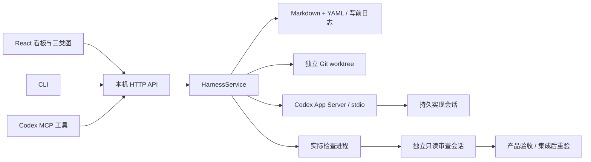

# 架构与不变量

## 边界

`core/` 拥有任务状态、依赖、授权、工作区、检查证据、审查、集成和记录规则。HTTP、CLI 与 MCP 调用同一个 `HarnessService`。React 只提供操作和投影，不能把任务直接设置为“通过”或“完成”。

## 记录权威

| 数据     | 唯一权威                         | 关键绑定                                            |
| -------- | -------------------------------- | --------------------------------------------------- |
| Project  | `.harness/project.yaml`          | schemaVersion、revision、检查配置                   |
| Task     | `.harness/backlog/tasks/<id>.md` | revision、authorizedRevision、依赖、完成条件        |
| 知识记录 | `.harness/records/<id>.md`       | kind、status、sourcePath、links、guards             |
| Run      | `.harness/runs/<id>.md`          | taskRevision、真实 threadId、工作区、基线、候选提交 |
| Evidence | `.harness/evidence/<id>.md`      | 代码指纹、检查配置摘要、真实退出码、用例统计        |
| 旧版本   | `.harness/history/…/rev-N.md`    | 旧任务与记录原文，只用于追溯                        |
| 临时状态 | `.harness/runtime/`              | 服务连接信息、写锁、事务意图，不纳入 Git            |

现有 README、架构说明、接口文档保持原位，通过知识记录的 `sourcePath` 登记；不复制成第二套规则。根 AGENTS 只增加简短导航。记录索引从文件重建，不依赖不可恢复的数据库。

## 状态机

`draft → queued → running → verifying → acceptance → done`。失败、暂停、未知结果与等待用户输入属于 Run，作为卡片标记展示，不伪装成产品已交付。

- 所有可编辑实体使用预期版本。任务修改产生新 revision、回到待澄清、取消旧授权。旧 Run 永远绑定旧版本。
- 授权与依赖满足才能派发。依赖必须是真实 ID，拓扑校验拒绝缺失节点和环，不使用递归遍历长链。
- 派发前持久化执行占位；拿到 `threadId` 后立即保存，再启动 turn。重复点击返回同一个活动 Run。
- 服务拥有进程租约；多条入口共享文件锁，关键多记录推进使用可恢复的写前日志。API 快照在锁内读取，不向用户发布半次状态推进。
- 重启、断连、超时可能留下未知结果；未知 Run 占用执行名额，核对前不会自动重建。
- 暂停不会删除代码；迟到的完成事件不能自动复活暂停任务。
- 任务检查或独立审查失败会保留缺陷记录。最多两次自动修复，之后阻塞；网络/协议错误不自动当作业务修复重试。

## 验证边界

每次检查都在实际候选工作区执行参数数组，不经 shell 字符串拼接。保存退出码、输出尾部、耗时、通过/失败/跳过数和前后代码指纹。至少一个行为检查实际通过，且所有配置检查通过，才能进入审查。构建成功、未发现测试、全部跳过、缺失结果、超时均不能冒充行为验证。

首版保守运行**全部项目检查**，不根据不完整的影响关系省略回归。`requiredCases` 绑定必须通过的具体事故用例；删除或跳过该用例即使其他测试通过也会失败。有效教训保护检查 ID、行为类型和必需用例，移除防线前必须处理教训的替代或退役。

指纹覆盖 Git 跟踪及非忽略的项目源码、测试、配置和文档，包含执行位和符号链接目标；排除 Harness 记录、依赖、构建输出与缓存。它不是供应链证明：外部服务、环境变量、未锁定的工具版本不能由源码指纹证明，项目应通过适配器与锁文件约束环境。

审查创建新的只读持久会话，绑定明确的提交差异和证据。独立上下文降低自我确认，不等于模型绝不会漏检。机械质量门槛仍由 Harness 执行；关键产品流程必须有适配测试和体验验收。

验收前核对任务版本、配置摘要、候选指纹、审查结果和主目录基线。集成意图在 Git 变更前保存；只允许快进集成。主基线移动时使用“更新基线并重验”，在候选工作区合并最新主线，不重写历史。冲突保留供修复，不自动 reset。集成后再次检查，失败保留提交并阻止验收完成。

历史任务的 `done` 与当前 `assurance` 分开：后续代码变化后，旧证据保守标为需重验。新任务检查通过不会被未经证明地归因于所有旧功能。

## 本地接入

HTTP 只监听 `127.0.0.1`，检查 Host 与 Origin；API 使用随机令牌，启动链接通过 URL fragment 传入，浏览器存入 sessionStorage。原生会话链接只包含真实 threadId，不承载模型提示词或 API 令牌。

MCP 连接已运行的本地服务，不自行再起一个调度器。项目自己的 Codex 配置继承当前身份与模型，角色配置不硬编码模型。App Server 的通知、问询与命令/文件许可请求转到看板；不自动同意原生审批。

本工具是同一用户权限下的项目协作工具，不是恶意 Agent 的安全隔离系统。真正的权限边界仍由 Codex sandbox、项目命令权限和操作系统提供。
